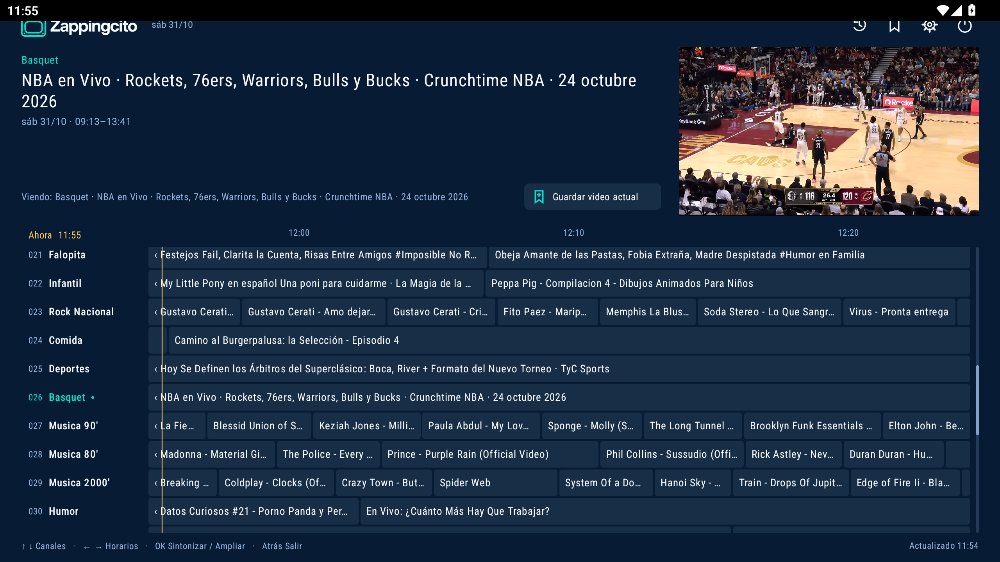
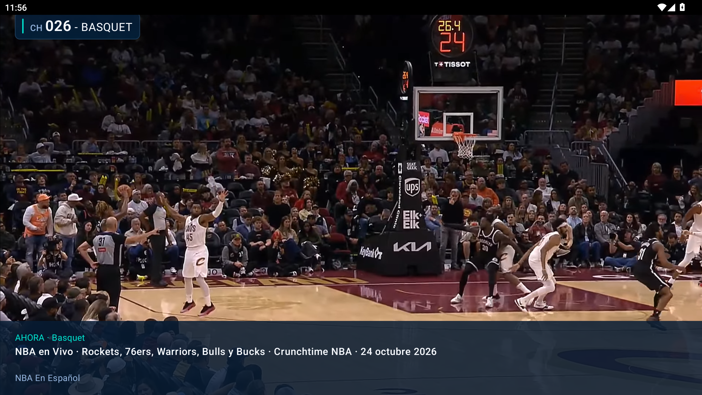

  

  <strong>YouTube para hacer zapping.</strong>

Videos de YouTube en español, armados en canales de viajes, cocina, música, autos y más. Abrís la app, cambiás de canal y mirás lo que te pinta.

Cada canal tiene su programación. Entrás y agarrás lo que está pasando, como en la tele.

Podés guardar videos o abrirlos en el celu con un QR.

**Para Android TV y Google TV. En desarrollo.**

## Descarga

**GitHub Releases:** [Descargar la APK de la última versión](https://github.com/andrescassanaz/zappingcito/releases/latest).

 **Downloader (by AFTVnews):** ingresá el código **6505895**.

## Capturas

Si te gusta Zappingcito y querés apoyar el proyecto, podés [invitarme un cafecito ☕](https://cafecito.app/zappingcito).
